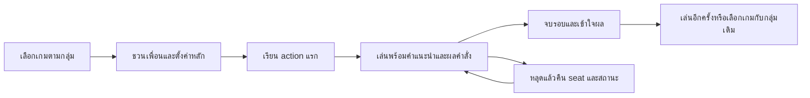

# KZ Game Hub — วิเคราะห์หลังแก้งานด่วนและเทียบเว็บบอร์ดเกมออนไลน์

วันที่ตรวจ 13 ตุลาคม 2026 (Asia/Bangkok) · source baseline `cb019bae` บน `main` · Game Studio + REA

ข้อเสนอหลักคือทำให้ **กลุ่มเพื่อนเลือกเกม เข้าห้อง เข้าใจหน้าที่ เล่นบนมือถือ และเริ่มรอบถัดไปได้ต่อเนื่อง**. ใช้ BGA เป็นแบบอย่างการเรียนรู้/สถานะเทิร์น, Colonist เป็นแบบอย่างการจัดคำสั่ง/มือถือ, Codenames เป็นแบบอย่างชวนเพื่อน/ภาษา และ Gartic เป็นแบบอย่างจังหวะของปาร์ตี้. เก็บ theme สีสด ขอบดำ ภาษาไทย และ server-authoritative ของ KZ ไว้.

งานด่วนก่อนหน้านี้แก้ Poker minimum raise/short all-in, Join/Coup overflow, มือไพ่ Slave 26 ใบ, Rules focus/Escape, test DB isolation และ Music preset/reconnect แล้ว. รายงานนี้เริ่มจากผลหลังแก้ ไม่ยกบั๊กเหล่านั้นมาเป็นงานใหม่. [ผลชุดด่วน](../qa/2026-10-13-urgent-fixes.md) · [แผนลงมือจาก benchmark](../superpowers/plans/2026-10-13-benchmark-adoption-plan.md)

## วิธีตรวจและระดับหลักฐาน

- **SOURCE:** graphify query, architecture/ADR, shared lobby/store/gateway/services, views และ tests ของ 14 GameTypes. แยก Gobbler/Ultimate เป็นโหมด Tic-Tac-Toe, ป๊อกเด้ง/Slave เป็น Card Game และ Online/Ledger เป็น Poker ตามเดิม.
- **RUNTIME:** Chromium 149, local Web3000/API3301, MySQL tmpfs สำหรับ tests เท่านั้น. เปิด Home TH/EN, Coup active ที่ 360/390/1280px, Detective Club setup, Who Am I HOST_INPUT, Saboteur active และ Gobbler lobby. ตรวจภาพ/geometry และทดลอง Escape ใน host-input modal.
- **REA:** passive CDP inventory/DOM/accessibility/scripts metadata ของหน้า local ที่ระบุ; export 8 Evidence records. REA ไม่ได้คลิกหรือเปิดหน้าให้ การควบคุมมาจาก Playwright. ไม่มี raw credentials/cookies/storage values/Socket payload ใน REA bundle. [ขอบเขตและ Evidence IDs](../qa/benchmark-2026-10-13/README.md)
- **BENCHMARK:** หน้าเว็บทางการ, developer help/UX guides และรายงานจากผู้ให้บริการ; เปิดหน้าสาธารณะ BGA/Colonist/Codenames เก็บภาพ. ไม่สมัครบัญชี ไม่ลงเล่นเกมสาธารณะ ไม่อ้างว่าได้ตรวจ paid/account-only flows หรือทุกเกมของบริการเหล่านี้.
- **PROPOSAL:** เป็นทางเลือกออกแบบ/เป้าหมายการทดสอบ แยกจากบั๊กที่เห็นจริง. ผู้ใช้ยืนยันแล้วว่าเน้น Thai-first private groups; ยังไม่มีผลจากกลุ่มผู้เล่นจริงหรือข้อมูล retention ของ KZ.

## เว็บที่ควรเทียบและหลักฐานความนิยม

| เว็บ                 | หลักฐานที่ตรวจได้                                                                         | จุดที่เหมาะกับ KZ                                                          | ข้อจำกัดในการเทียบ                                                                         |
| -------------------- | ----------------------------------------------------------------------------------------- | -------------------------------------------------------------------------- | ------------------------------------------------------------------------------------------ |
| **Board Game Arena** | รายงานปี 2025 เผยแพร่ 9 ม.ค. 2026: จบ 78 ล้านโต๊ะ realtime และ 17.5 ล้านโต๊ะ turn-based   | interactive learning, state/action clarity, game catalog, ผลและ replay     | ตัวเลขโต๊ะไม่ใช่ผู้เล่น unique; เป็น รายงานจากผู้ให้บริการ ไม่ใช่ การตรวจ traffic โดยอิสระ |
| **Colonist**         | รายงาน 4 ก.พ. 2026: 2025 มี yearly active3.6 ล้าน, monthly average501K, เล่น 60 ล้านเกม   | friends/online entry แยกชัด, room settings, action/response layout, มือถือ | เป็นตัวเลขของผู้ให้บริการ; yearly active/MAU/เกมห้ามนำไปจัดอันดับตรงกับ BGA                |
| **Codenames Online** | official page ยืนยัน create→settings→room link, browser/no-account และหลายภาษา            | เข้าห้องง่าย, หน้าที่ตามบทบาท, word packs                                  | ตัวเลข 4M unique กับ 4M/month บนหน้าเดียวกันมี scope ไม่ชัด จึงไม่ใช้คำนวณอันดับ           |
| **Tabletopia**       | official About ระบุ catalog2,500+เกม; guide มี search/filter/collections                  | สำรวจเกม, ตรวจชิ้นส่วน, table space, setup presets                         | จำนวนเกมไม่ใช่ผู้เล่น; sandbox ให้ผู้เล่นดูแลกติกาหลายส่วน แตกต่างจาก KZ                   |
| **PlayingCards.io**  | official Press/Quick Start อธิบาย room code และโต๊ะร่วมใน browser                         | invite friction ต่ำ, private hand, card/table layout                       | ไม่พบสถิติผู้ใช้ปัจจุบันที่เทียบได้; manual rules ไม่เหมาะจะนำมาแทน engine                 |
| **Gartic Phone**     | official homepage แสดง nickname/avatar, อธิบาย write→draw→guess→reveal และ external voice | onboarding สั้น, จังหวะปาร์ตี้, shared reveal                              | ใช้เป็น UX reference; ไม่อ้างว่ามี web MAU มากกว่าเว็บอื่นจาก Android downloads            |

แหล่งตัวเลข: [BGA 2025 report](https://en.boardgamearena.com/news?id=1025), [Colonist 2025 report](https://blog.colonist.io/colonist-io-2025-summary/). แหล่งรูปแบบ: [Codenames official](https://www.codenamesgame.com/play-online), [Tabletopia About](https://tabletopia.com/about), [PlayingCards Press](https://playingcards.io/press), [Gartic Phone](https://garticphone.com/). ตัวเลขรายงานประจำปีเหมาะกว่าตัวนับ online แบบ snapshot บน landing page; ไม่มีอันดับความนิยมรวมที่คำนวณอย่างมีเหตุผลจากข้อมูลต่างหน่วยนี้.

## สิ่งที่ KZ มีดีและควรต่อยอด

1. **เข้าห้องแบบเบา:** nickname, invite URL, code, QR, TH/EN มีอยู่แล้ว ไม่ควรเพิ่ม account wall ก่อนเกม.
2. **กติกาที่ server ตัดสิน:** แยก game services, public room กับ private state, reconnect token ต่อ seat และ named timers. ใช้โครงนี้ทำ feedback ที่ชัดขึ้น.
3. **หลายเกมแต่เครื่องมือร่วม:** catalog metadata, Rules, GameStatusHeader และ tests/sim มีแล้ว. ปรับ shared primitives ครั้งเดียวแล้วใช้ทั้ง 14 เกม.
4. **เอกลักษณ์ไทย:** ชื่อ/ธีม เช่น บ้านทรายทองและเกมไพ่ไทยเป็นข้อแตกต่างที่มีคุณค่า. ใช้ benchmark เพื่อแก้ interaction ไม่คัดลอกภาพ/branding/เนื้อหาเกม.

## ข้อพบหลังแก้ที่ควรจัดลำดับ

P1 = คำสั่งสำคัญ/ความต่อเนื่อง/การเข้าถึง; P2 = ความเข้าใจและคุณภาพ; P3 = ขยายเมื่อมีข้อมูล. คำว่า risk หมายถึงยังต้องทำ test ยืนยัน ไม่ใช่พบ exploit แล้ว.

| ID   | ระดับและหลักฐาน               | สิ่งที่พบ                                                                                                                                         | ผลต่อผู้เล่น / แนวแก้                                                                                                                                  |
| ---- | ----------------------------- | ------------------------------------------------------------------------------------------------------------------------------------------------- | ------------------------------------------------------------------------------------------------------------------------------------------------------ |
| B-01 | P1 SOURCE                     | actionLoading ปลดจาก room broadcast ใดก็ได้; action ไม่มี correlated ID/ack                                                                       | บอกไม่ได้ว่าคำสั่งของฉันถูกยอมรับหรือไม่. นำร่อง action receipt/stateVersion กับ Classic/RPS ก่อนขยาย                                                  |
| B-02 | P1 SOURCE-derived risk        | Sounds Fishy/WhoAmI async start ตรวจ LOBBY ก่อน await; wrapper ป้องกันห้องถูกลบแล้ว แต่ไม่ตรวจ concurrent generation/config/roster ใน object เดิม | ผลตอบช้าอาจใช้กับเงื่อนไขใหม่. เพิ่ม start generation/lock และ revalidate ก่อน commit ด้วย deferred mocks                                              |
| B-03 | P1 SOURCE + REA               | Gobbler inventory เป็น clickable div; Saboteur มี board buttons หลายช่องไม่มีชื่อ; DC play/zoom พึ่ง overlay/hover                                | keyboard/screen reader/touch ใช้คำสั่งไม่เท่ากัน. Native controls, coordinate labels, visible inspect affordance                                       |
| B-04 | P1 SOURCE                     | Music ReactPlayer onError และ play rejection แจ้ง console แต่ UI ใช้ Now playing                                                                  | คนไม่ได้ยินเพลงไม่รู้วิธีแก้. แยก local media states และ retry รอบเดิม; gesture/iOS ต้องตรวจจริง                                                       |
| B-05 | P1/P2 RUNTIME + REA           | WhoAmI HOST_INPUT modal ยังคง Set Words/Cancel/Start Game และ copy อังกฤษเมื่อ TH; Escape ไม่ปิด; AX ไม่มี dialog role                            | ไม่สอดคล้องภาษา/keyboard. ใช้ dictionary+GameDialog และรักษา draft เมื่อ reject; ตรวจ roster ID ปัจจุบัน                                               |
| B-06 | P2 RUNTIME                    | Home360 สูงราว 2,750px; Coup360 สูง 1,525px โดย primary income action อยู่ต่ำกว่า viewport แรก; DC input/Confirm อยู่หลัง role/setup/hand panels  | เกมอ่านได้แต่ลงมือช้า. ให้ phase/board/hand/action มาก่อน secondary panels; ปุ่มหลักอยู่ใกล้บริบทการเลือก                                              |
| B-07 | P2 SOURCE + REA               | GameStatusHeader เฉพาะ Who Know มี promptKey ตามหน้าที่; เกมอื่นใช้ generic next action                                                           | ผู้เล่นใหม่ยังต้องเดาว่าทำอะไร. เพิ่ม phase+role prompt registry ที่ใช้ข้อมูลเท่าที่ผู้เล่นมีสิทธิ์รู้                                                 |
| B-08 | P2 SOURCE                     | ทุก lobby ถูกส่ง code/hostName/count ใน availableRooms; join/spectate ไม่มี visibility policy                                                     | ปัจจุบันเป็น public lobby. เสนอ public/unlisted/invite-only ชัด; unlisted ไม่ใช่ authorization และไม่กล่าวว่า private hand รั่ว                        |
| B-09 | P1 ก่อนขยายสาธารณะ SOURCE gap | มี shape validation แต่ในเส้นทางที่ตรวจไม่พบ rate/admission caps                                                                                  | ควรมี per-socket event/read/create bounds, room capacity, observer caps และเหตุผล reject; ทดสอบ burst เฉพาะ local                                      |
| B-10 | P2 SOURCE                     | WhoFirst result วัดเวลาถึง server; countdown อิง client clock                                                                                     | อธิบาย network contribution และใช้ server offset เพื่อ display. ไม่ trust client timestamp ตัดสินผู้ชนะ                                                |
| B-11 | P2 SOURCE                     | leaderboard รวมชื่อ free text/หลายเกม; ties ได้ idx+1; result write failure ถูก catch หลัง mark recorded                                          | label เป็น casual stats, แยก per game, tie-aware rank, idempotent result write/bounded retry; ไม่ต้องสร้าง account system ทันที                        |
| B-12 | P2 ก่อน scale SOURCE          | rooms/sessiontokens/timers อยู่ API process เดียว; deploymain กับ nightly tests แยกกัน                                                            | วัด capacity/bytes/eventloop/timer ก่อนเพิ่มเครื่อง; room ownership ต้องชัด. เสนอ critical PR checks เป็น policy decision; ไม่เปลี่ยน live state ไป DB |

ไฟล์หลักฐานที่ตรวจ:

- B-01: [useGameStore.ts](../../apps/web/src/store/useGameStore.ts) L174–187 / L354–382.
- B-02: [sounds-fishy.service.ts](../../apps/api/src/games/sounds-fishy/sounds-fishy.service.ts) L69–110; [who-am-i.service.ts](../../apps/api/src/games/who-am-i/who-am-i.service.ts) L152–191 / L283–298; [games.service.ts](../../apps/api/src/games/games.service.ts) L902–914 / L1027–1037.
- B-03: [GobblerView.tsx](../../apps/web/src/components/games/gobbler/GobblerView.tsx) L175–187; [PlayingPhase.tsx](../../apps/web/src/components/games/detective-club/phases/PlayingPhase.tsx) L140–159; [SaboteurView.tsx](../../apps/web/src/components/games/saboteur/SaboteurView.tsx) L243–296. [REA accessibility](../qa/benchmark-2026-10-13/README.md).
- B-04: [MusicTriviaView.tsx](../../apps/web/src/components/games/music-trivia/MusicTriviaView.tsx) L491–523.
- B-05: [LobbyStartButton.tsx](../../apps/web/src/components/lobby/LobbyStartButton.tsx) L128–190; [WhoAmIView.tsx](../../apps/web/src/components/games/who-am-i/WhoAmIView.tsx) L73–84 / L123–176 / L697–718. [ภาพ TH จริง](../qa/benchmark-2026-10-13/who-am-i-actual-th-360.png).
- B-06/B-07: [GameViewManager.tsx](../../apps/web/src/components/lobby/GameViewManager.tsx), [GameStatusHeader.tsx](../../apps/web/src/components/games/GameStatusHeader.tsx); [Coup screenshot](../qa/benchmark-2026-10-13/coup-playing-360.png), [DC screenshot](../qa/benchmark-2026-10-13/detective-initial-360.png).
- B-08/B-09: [games.service.ts](../../apps/api/src/games/games.service.ts) L149–259 / L379–394 / L586–603; [games.gateway.ts](../../apps/api/src/games/games.gateway.ts) L1549–1559 / L1933–2127.
- B-10: [who-first.service.ts](../../apps/api/src/games/who-first/who-first.service.ts) L117–137; [WhoFirstView.tsx](../../apps/web/src/components/games/who-first/WhoFirstView.tsx) L24–36.
- B-11: [leaderboard.service.ts](../../apps/api/src/games/leaderboard/leaderboard.service.ts) L13–36; [games.gateway.ts](../../apps/api/src/games/games.gateway.ts) L2135–2147.
- B-12: [PlayerSessionService](../../apps/api/src/games/player-session.service.ts), [RoomTimerService](../../apps/api/src/games/room-timer.service.ts), [deploy workflow](../../.github/workflows/deploy.yml), [nightly workflow](../../.github/workflows/test-nightly.yml).

## 8 รูปแบบที่นำมาใช้ได้

### 1. เลือกเกมที่เหมาะกับกลุ่มก่อนเปิด settings

ต่อยอด metadata ที่มีแล้วด้วย filter จำนวนคน/ร่วมมือหรือแข่งขัน/ต้องใช้เสียง/ต้องพิมพ์. ตั้งค่า default ที่ปลอดภัย และแสดง Advanced Rules เมื่อ host เปิดเอง. เวลาที่ใช้เล่นควรได้จาก playtest หรือระบุว่า estimate; ไม่ใส่เวลาที่เดาเอง. อิง [Tabletopia beginner guide](https://help.tabletopia.com/knowledge-base/beginners-guide/) และ [BGA game page](https://en.boardgamearena.com/gamepanel?game=super).

### 2. ห้องรอให้ชวนเพื่อนและเริ่มเกมเป็นงานหลัก

KZ มี Copy/QR อยู่แล้ว ควรให้ share เป็น CTA ที่เห็นชัด พร้อม joined/connected/ready/minimum count และ start reason. Invite URL มี room code แต่ไม่ใส่ reconnect token/role/word. คง code fallback และ anonymous nickname ตาม [Codenames official flow](https://www.codenamesgame.com/play-online) และ [PlayingCards Quick Start](https://playingcards.io/docs/overview).

### 3. สอน action แรกในบริบท

ใช้หนึ่งหน้าก่อนรอบแรก: เป้าหมาย→หน้าที่→คำสั่งแรก. กติกายาวอยู่ใน Rules เดิม. นำร่อง practice Classic/RPS และคำแนะนำ Coup; ไม่ต้องสร้าง replay engine ก่อน. [BGA tutorial guide](https://jsrpg.boardgamearena.com/tutorialfaq) ใช้การลงมือทำจาก replay เป็นแบบอย่างด้าน learning แต่การทำ full replay ของ KZ เป็นโครงการแยก.

### 4. Status/action contract เดียวกัน

แสดง phase, หน้าที่ของฉัน, legal next action, คนที่รอ, deadline และผลคำสั่งอย่างสอดคล้องกัน. Pending ต้องสัมพันธ์กับคำสั่งจริง ไม่สรุปจาก broadcast อื่น. นำแนวทางจาก [BGA UX Guidelines](https://en.doc.boardgamearena.com/images/5/57/Guidelines_UX_new_compressed.pdf) มาร่วมกับ server contract ของ KZ.

### 5. แสดงสิ่งที่จ่าย/เลือก/รับผลก่อนยืนยัน

Coup: action→target→cost→claim→response; Poker: call amount/raise-to/additional chips/resulting stack; ป๊อกเด้ง: stake→multiplier→delta. ช่วยเข้าใจความหมาย ไม่ชี้แนะว่าควร bluff อย่างไรหรือเปิดไพ่คนอื่น. [Colonist trade redesign](https://blog.colonist.io/improving-the-colonist-trade-system/) แสดงการแก้ confusion ด้วย layout และสถานะ accept/reject/waiting.

### 6. มือถือให้สนามและ action มาก่อน panels

Phase strip สั้น, board/hand เข้าถึงง่าย, inspect ด้วย tap, scroll มี affordance, player/history/settings พับได้. อาจมี action dock บางเกม แต่ต้องไม่บัง hand/keyboard/board และไม่บังคับ orientation. [Colonist portrait article](https://blog.colonist.io/why-colonist-is-going-portrait-on-mobile/) เป็นประสบการณ์ของผลิตภัณฑ์นั้น ไม่ใช่หลักฐานว่าทุกเกม KZ ต้อง portrait-only.

### 7. กลับเข้าห้องแล้วรู้ว่าตอนนี้ถึงไหน

ใช้ reconnect ที่แก้แล้วเป็นฐาน: คืน phase/seat/private state เดิม, สรุป public events ล่าสุด, แจ้ง host transfer และเหตุผลเมื่อห้องหาย. [Tabletopia FAQ](https://help.tabletopia.com/knowledge-base/faq/) มีแนวคิด returning vs closing room; KZ ไม่ควรรับปากการกู้ห้องหลัง server restart เพราะ live rooms อยู่ memory.

### 8. จบรอบให้เป็นเหตุการณ์ร่วมกันและเล่นต่อสะดวก

สรุปใครชนะและเพราะอะไร, คะแนนก่อน→หลัง, public reveal ตามกติกา, rematch settings เดิม และกลับเลือกเกมกับกลุ่มเดิม. [Gartic homepage](https://garticphone.com/) เน้นการดูผลร่วมกัน; rematch/change-game เป็นข้อเสนอสำหรับ KZ ไม่ใช่ฟีเจอร์ที่เราได้ทดสอบใน Gartic. การเปลี่ยนเกมข้ามประเภทต้องออกแบบ reset/private-state/session/score semantics ก่อน ไม่ใช่เปลี่ยน `room.gameType` ตรง ๆ.

## แผนรายเกม

| เกมและแผนเดิม                                                                    | งานถัดไปหลัง urgent fixes                                                         | เกณฑ์ที่ใช้รับงาน                                                                 |
| -------------------------------------------------------------------------------- | --------------------------------------------------------------------------------- | --------------------------------------------------------------------------------- |
| [Who Know](../superpowers/plans/2026-10-13-who-know-improvements.md)             | lifecycle ปิด role card เมื่อ blur/ข้ามรอบ, reveal เหตุผลคะแนน                    | เปิดใหม่ต้องกดเองหลัง blur; ไม่มี word ปรากฏให้คนผิดบทบาท                         |
| [Tic-Tac-Toe](../superpowers/plans/2026-10-13-tic-tac-toe-improvements.md)       | Gobbler keyboard, named cells, Ultimate next-board/touch preview                  | เล่นครบด้วย keyboard; 360px รู้ targetboard โดยไม่ hover                          |
| [RPS](../superpowers/plans/2026-10-13-rps-improvements.md)                       | ชื่อตัวเลือกและ sealed/reveal; Round Robin คิวคนพัก                               | ตัวเลือก 3 ชื่ออ่านได้; resting player แยกจาก viewer                              |
| [Sounds Fishy](../superpowers/plans/2026-10-13-sounds-fishy-improvements.md)     | async start guard/libraryerror, true/fake/picker prompts, ลดความถี่ typing events | emptyTHpool กับ DBfailure มีข้อความต่างกัน; race ไม่ start ซ้ำ                    |
| [Detective Club](../superpowers/plans/2026-10-13-detective-club-improvements.md) | tap inspect/play, dialog focus, role/setup panels กระชับ                          | touch ไม่ต้อง hover; Tab/Escape/restore และคะแนนอธิบายได้                         |
| [Who Am I](../superpowers/plans/2026-10-13-who-am-i-improvements.md)             | TH modal, required player IDs, preserve draft, asyncgeneration guard              | TH ไม่มี ข้อความอังกฤษ ตกหล่น; reject ยังมี draft; roster/remap ไม่หลุด           |
| [Who First](../superpowers/plans/2026-10-13-who-first-improvements.md)           | GO แบบภาพ/ข้อความ/เสียง, display clock offset, timingcopy                         | muted/reducedmotion เล่นได้; clock±5s ไม่หลอก deadline                            |
| [Music Trivia](../superpowers/plans/2026-10-13-music-trivia-improvements.md)     | media states/error/retry, การกด Ready, providerfeedback                           | จำลอง play rejection/404 เห็นปุ่มแก้; retry ไม่ reset รอบหรือเผย answer           |
| [The Mind](../superpowers/plans/2026-10-13-the-mind-improvements.md)             | ready คนที่รอ, Extreme pilelabels, optional reveal skip                           | ผลอ่านได้เมื่อ skip; ไม่ให้ hint ลำดับไพ่เพื่อนระหว่างเกม                         |
| [Saboteur](../superpowers/plans/2026-10-13-saboteur-improvements.md)             | board zoom/pan/named cells, action target prompt, รักษา selection                 | MAP/ROCKFALL/BREAK/REPAIR เป้าหมายต่างกันชัด; peek ยัง private                    |
| [Coup](../superpowers/plans/2026-10-13-coup-improvements.md)                     | cost/claim/responsepreview, countdown, exchangeselectedstate                      | target/thirdparty สิทธิ์ตรง server; timer ไม่ reset หลัง reconnect                |
| [Card Game](../superpowers/plans/2026-10-13-card-game-improvements.md)           | Slave sort/trickcompatibility/draft หลัง reject; ป๊อกเด้ง settlement              | ไพ่ selection ตรง stableid; ชิปก่อน/หลัง/ตัวคูณตรวจสอบได้                         |
| [Banana Thief](../superpowers/plans/2026-10-13-banana-thief-improvements.md)     | readiness/audiofailure, visual wake cue ตามสิทธิ์, force-start confirmation       | muted/blocked เล่นได้; force-start บอกผลและคนไม่ ready                            |
| [Poker](../superpowers/plans/2026-10-13-poker-improvements.md)                   | รายละเอียด pot/contribution/ผู้มีสิทธิ์, ยืนยันการแจก pot ใน ledgeration/receipt  | all-ins ที่ยอดไม่เท่ากัน/split/odd chips ถูก; award ไม่ทำซ้ำ; minraise เดิมคงผ่าน |

## ลำดับที่แนะนำ

1. **Interaction และ reliability ที่เห็นปัญหา:** B-01/B-02/B-03/B-04/B-05. นำร่อง sharedreceipt ใน Classic/RPS, dialog ใน WhoAmI/DC, media ใน Music.
2. **เรียนรู้และเล่นบนมือถือ:** B-06/B-07 + lobby/share/catalog filters + Coup/DC/Saboteur/Ultimate mobile. ทดสอบกับคนใหม่ก่อนย้ายทุกเกม.
3. **จบแล้วเล่นต่อ:** public recaps/score explanations/rematch; กำหนดกลุ่ม/host/session/คะแนนเมื่อเปลี่ยนเกม.
4. **ก่อนเปิดห้องสาธารณะกว้าง:** B-08/B-09/B-11, moderation/reporting policy และ critical CI checks ตามข้อตกลงทีม.
5. **เมื่อผลวัดบอกว่าจำเป็น:** production bundle/LCP/INP/render frequency/state bytes/event loop lag/timer lateness; room ownership/scale/replay infrastructure.

## วิธีวัดว่าเว็บดีขึ้นจริง

นำร่องกลุ่มใหม่ 2 กลุ่ม กลุ่มละ 3–5 คน และคู่ 2 คนสำหรับเกมแข่งขัน; ใช้ TH เป็นหลัก และมี ENpass. เก็บ invite→join, lobby→first accepted action, invalid/rejected actions ต่อ phase, การกดผิดตำแหน่ง, room recovery, การเล่นรอบที่ 2 ในกลุ่มเดิม และคำถามว่า “ตอนนี้ต้องทำอะไร”. Metrics ไม่มีชื่อ/role/word/hand/token/raw chat/full state.

เป้าหมายเสนอสำหรับ pilot: อย่างน้อย 80%ทำ action แรกได้โดยไม่ถามผู้ดำเนิน test, ไม่มีคำสั่งหลักถูกตัด/เข้าถึงไม่ได้ที่ 360px, failure/reject มีทางกลับโดย draft ไม่หาย. ตัวเลขนี้เป็นเกณฑ์ตั้งต้นที่ต้องตกลง/วัด ไม่ใช่ผลที่ KZ ผ่านแล้ว. Interactionlatency และ retention ให้วัด baseline ก่อนตั้ง threshold.

## ขอบเขตที่ยังไม่ได้พิสูจน์

ยังไม่มี production performance/loadtest, Safari/Android จริง, screen reader จริง, live music providers, account/paid flows ของคู่เทียบ, race reproduction หรือ tests ใหม่ของแผนทั้งหมด. ชุด urgent เดิมมี API653/browser26/sim12 ตามบันทึกเดิม; ไม่ได้นับ browserobservations รอบนี้เป็นการเล่น 14 เกมจนจบ. REA ไม่เก็บ network ก่อน attach/rawframes จึงไม่ใช้คำว่าไม่มี payload รั่วจาก capture ที่ไม่มี traffic.

สิ่งที่ยังไม่ควรรีบทำ: engine rewrite ไป Phaser/3D, obligatory accounts, fullmatchmaking/ranked/tournaments, persistentlivestate ใน DB, voice chatserver และ full tutorial/replay framework. แต่ละอย่างต้องมีปัญหาผู้เล่นหรือ capacity ที่วัดได้รองรับก่อน.
