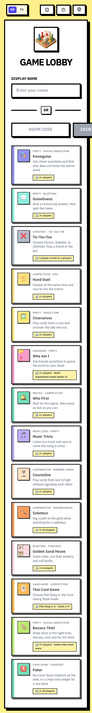
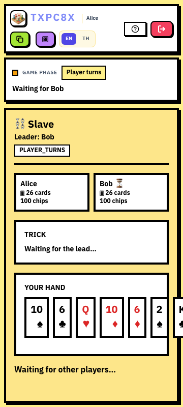
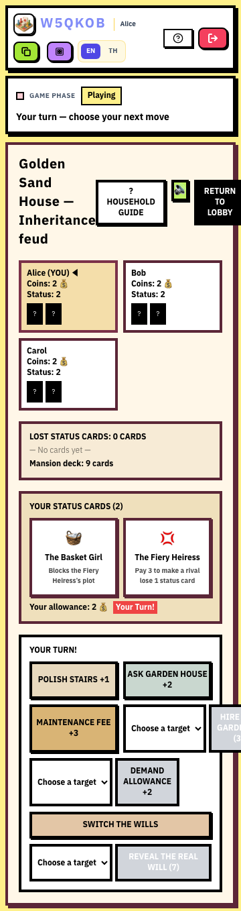
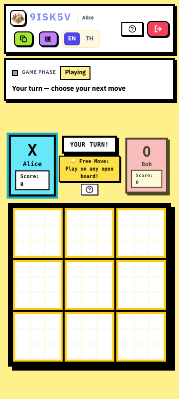
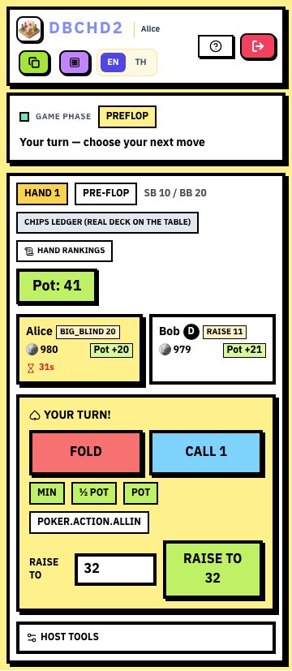

# KZ Game Hub — หลักฐานการตรวจสำหรับแผนปรับปรุง

วันที่ 13 ตุลาคม 2026 · baseline `c03c820c` · ใช้ [Game Studio](plugin://game-studio@openai-curated-remote) ผ่าน game-playtest/game-ui-frontend และตรวจ source graph ด้วย graphify

## วิธีตรวจและขอบเขต

- ตรวจ catalog ทั้ง 14 GameType, views/settings/rules, shared lobby/store, game services/types, E2E/sim matrix, ADR และแผน UI วันที่ 8 ตุลาคม
- เปิดด้วย `pnpm dev` ได้ทั้ง packages/API/web compilation ไม่มี TypeScript error ใน startup. พบว่า Turbo strict env ไม่ส่ง PORT/DATABASE_URL/DISABLE_GAME_SETTINGS_DB ที่ไม่กำหนดใน config: API ใช้ 3001 แทน 3101 และมี GameSetting query. หยุด process ก่อนสร้างหรือเล่นห้องจาก browser แล้วเริ่ม `pnpm -F api dev` และ `pnpm -F web dev` โดยตรง
- Browser audit ใช้ API3101/Web3000 และ DATABASE_URL เป็น `127.0.0.1:13306/audit` ที่ไม่มี DB ให้เชื่อมต่อ; ปิด GameSettings DB. ไม่รัน db:push/seed/migrate/reset. การโหลด artist preset/คำถาม/บันทึกผลที่พยายามทำใน audit จึงไม่แตะ production
- Chromium: Desktop1280×900 และ Mobile360×800; Home สลับ TH/EN; เกมส่วนใหญ่ใช้ EN ตาม fixture เดิม. นี่เป็น viewport simulation ไม่ใช่ iOS/Android device certification
- จับ 19 sessions: Knowguise, GuiseGuess, TTT3 โหมด, RPS, Cluecanvas, WhoAmI2 โหมด, WhoFirst, MusicTrivia, TheMind, Saboteur, Coup, BananaThief, ThaiCard2preset, Poker2 โหมด. Home/modal/offline+session captures รวม 61 observation records ในชุดแรก
- ตรวจ active board เพิ่ม Classic/Gobbler/Ultimate และ Poker ledger; ส่ง raise21 เพื่อดูยอดที่ server ยืนยัน. มี screenshot/JSON บนเครื่องใน `DELIVERY/game-audit-2026-10-13/` และเก็บภาพตัวอย่างประกอบที่ `docs/qa/game-audit-2026-10-13/`

## ผลการรัน

| ชุดตรวจ                                          | ผล                         | สิ่งที่สรุปได้                                                                                                                                                                                                            |
| ------------------------------------------------ | -------------------------- | ------------------------------------------------------------------------------------------------------------------------------------------------------------------------------------------------------------------------- |
| Capture catalog/lobbies/initial state19 sessions | ผ่าน 1test                 | เปิดหน้า/จับภาพได้ ไม่ได้แปลว่า 19 sessions เล่นจบ                                                                                                                                                                        |
| Existing sim driver Classic2P                    | ผ่าน                       | เล่นจนผลลัพธ์ตาม driver assertions                                                                                                                                                                                        |
| Existing sim driver RPS BO1 Round Robin          | ผ่าน                       | เลือกและ resolve แมตช์ได้                                                                                                                                                                                                 |
| Existing sim driver Poker Online                 | ผ่าน                       | check/call→showdown→result ตาม driver                                                                                                                                                                                     |
| Existing sim driver Poker Ledger                 | ผ่าน                       | check/call→host award→result ตาม driver                                                                                                                                                                                   |
| Active-board/raise capture                       | ผ่าน 1 test ใน 23.7 วินาที | รอบก่อนหน้า fail เพราะ locator Gobbler ไม่ตรงและคาด label RAISE21 ทั้งที่ log แสดงยอดเติม 11; แก้ audit harness แล้วจับ active boards ทั้งสามโหมดได้. ผล pot 41 / seat contribution 21 ยืนยันว่า server รับยอดรวม 21 แล้ว |

5tests ชุดแรกผ่านใน 2.8 นาที. การรันเสริมเป็น observational test ไม่ใช่ regression ที่ assert ว่ากติกาถูก: มันบันทึกพฤติกรรม 21 ที่ต้องแก้. ไม่ได้รัน Jest ทั้งหมด, sim ทุก variant, production build, Safari, screen reader จริง, audio จริงทุก provider หรือหลายอุปกรณ์ผ่านอินเทอร์เน็ต.

## Findings ที่มีหลักฐาน

| ID      | ระดับ/ประเภท          | ทำซ้ำและสิ่งที่เห็น                                                                                                                                                                                                            | เจ้าของโค้ด / แผน                                                                            |
| ------- | --------------------- | ------------------------------------------------------------------------------------------------------------------------------------------------------------------------------------------------------------------------------ | -------------------------------------------------------------------------------------------- |
| HUB-01  | P1 UI                 | Home360px EN: input room code + Join แถวเดียว; ปุ่ม Join อยู่เลยขอบ viewport. document.scrollWidth ยัง 360 เพราะ overflow hidden จึงตรวจ scrollWidth อย่างเดียวไม่พอ                                                           | `HomeView.tsx` SH-2                                                                          |
| HUB-02  | P1 UI+CODE            | เปิด How to Play→กด Escape→Close rules ยัง visible; ไม่มี dialog role/focus trap ใน RulesModal                                                                                                                                 | `RulesModal.tsx` SH-3                                                                        |
| HUB-03  | P1 UI+CODE            | ปิด network ในห้อง Classic→เห็น Connecting อย่างเดียว; page แทนที่ room ทั้งหน้า. store ยังเก็บ socket, emitter ไม่ได้เช็ก connected และล้าง pending จากทุก room broadcast. replay ของ stale action เป็น risk ที่ต้อง test แยก | `page.tsx`, `useGameStore.ts` SH-4                                                           |
| CARD-01 | P1 UI+CODE            | Slave2 คน→คนละ 26 ใบ→360px: มือไพ่แถวเดียวยื่นพ้นกรอบและใบหลัง ๆ ถูกตัด; CardHand ไม่มี scroll container ของตัวเอง                                                                                                             | `CardHand.tsx`, `SlaveView.tsx` CA-1                                                         |
| COUP-01 | P1 UI                 | StartCoup3 คน→360px: Return to lobby และ Hire the gardener(3)อยู่นอกขอบจอ; title/utility/action row ไม่ reflow                                                                                                                 | `CoupView.tsx` CP-1                                                                          |
| PK-01   | P1 UI+CODE            | LedgerSB10/BB20: action แรกเสนอ Raise to21. กดยืนยัน→pot รวม 41 และผู้ raise รวม 21; server รับแล้ว. `startHand`ตั้ง minRaiseTo40 ก่อนโพสต์ blind แต่เขียนทับ 20 ภายหลัง                                                       | `poker.service.ts:239,271`, `poker-engine.ts:419` PK-1                                       |
| PK-02   | P1 CODE               | BET/ALL_IN คำนวณ raiseSize จาก seat.bet เดิมแทน previous currentBet; capped minimum ของ legalMoves ทำให้ service ตี short raise เป็น full raise. ต้อง regression ทั้งสอง mode และ 3+seats                                      | `poker.service.ts:315–343`, `poker-engine.ts:419` PK-1                                       |
| PK-03   | P2 UI+CODE            | Poker แสดง POKER.ACTION.ALLIN, shared phasePREFLOP และ last actionBIG_BLIND/SMALL_BLIND เป็น raw. quick keyallin ไม่ตรง dictionaryallIn                                                                                        | `PokerView.tsx`, dictionaries, `GameViewManager.tsx` PK-2/SH-5                               |
| MT-01   | P1 CODE               | เลือก artistPresetId แต่ query ว่าง→LobbyStartButton ยัง disabled; serviceconfigure รองรับ preset โดยไม่ต้อง query                                                                                                             | `LobbyStartButton.tsx:52`, `music-trivia.service.ts:303` MT-1; ยังไม่ทดลองกับ catalogDB จริง |
| DC-01   | P1 CODE               | Hand ลงภาพเป็น div onClick; preview opacity 0 จน hover; ภาพที่ลงแล้วใช้ div onClick. confirmation มีอยู่แล้ว; viewer มี Escape อยู่แล้วแต่ focus semantics ยังไม่ครบ                                                           | `detective-club/phases/PlayingPhase.tsx`, `CardViewerModal.tsx` DC-1/DC-2                    |
| TT-01   | P1 CODE+UI            | Gobblerinventorydiv onClick ไม่อยู่ใน Tab; Classic/Ultimateempty buttons ไม่มีชื่อ; Ultimatepreview ใช้ mouseEnter. activeUltimate360px เห็น 81 ช่องเล็ก — เป็น usabilityrisk ไม่ใช่การสรุปว่า 81 ช่องผิด WCAG                 | views ทั้ง 3 โหมด TT-1/TT-2/TT-3                                                             |
| WA-01   | P2 CODE+UI            | host-input modal มี Set Words/Assign a word/Cancel/Start Gamehardcoded อังกฤษ; view มีข้อความ host input อังกฤษ. PLAYER_INPUT ล้าง draft ก่อนทราบ acceptance                                                                   | `LobbyStartButton.tsx`, `WhoAmIView.tsx` WA-1/WA-2                                           |
| SF-01   | P1 CODE/จำกัด runtime | DBempty/failed คืน null และ gateway ใช้ startfailure ทั่วไป; audit ใช้ DB ที่ไม่มีจึงไม่ได้เล่นรอบคำถาม. ห้ามอ้างว่ากติกา GuiseGuess พังเพราะ capture ยัง Starting หลัง 1s                                                     | `sounds-fishy.service.ts:84–114`, `games.gateway.ts` SF-1                                    |
| WF-01   | P2 CODE               | PRESS ใช้ server receiveDate.now−activeStartTime; UIclock เป็น local Date.now. เวลา reaction ที่เห็นจึงมี network delay และ clock display อาจ skew                                                                             | `who-first.service.ts:117–132`, `WhoFirstView.tsx` WF-2                                      |
| A11Y-01 | P2 CODE               | useReducedMotion ชัดใน Knowguise/RoleCard; views อื่นมี bounce/pulse และไม่มี globalreduced-motion CSS. ปุ่มบางจุดเล็กกว่า 24px ต้องตรวจ spacing exception ก่อนกล่าวว่าผิด WCAG                                                | `globals.css`, gameviews SH-3                                                                |
| QA-01   | P0 CODE+startup       | Playwrightconfigs โหลด root.env และปิด GameSettings เพียงอย่างเดียว; Leaderboard เขียน GameResult, SoundsFishyupdatequery_count. nightly มี localMySQL อยู่แล้วแต่ localcommand ไม่ได้ guardDB                                 | Playwrightconfigs/Turbo/Leaderboard SH-1                                                     |

การตรวจตำแหน่ง DOM มี false positives ที่เป็นของตั้งใจเลื่อน เช่นแท็บใน Rules และมือไพ่บางเกม. Findings ที่สรุปว่าถูกตัดพิจารณาภาพจริงร่วมกับ source ไม่ได้นับทุก control นอก viewport เป็นบั๊ก. screenshotHomeTH จับใกล้การสลับภาษาและ style อาจยังไม่ settle จึงไม่ใช้เป็นหลักฐาน geometry ภาษาไทย.

## ตัวอย่างภาพ

### Home มือถือ — ปุ่มเข้าห้องถูกตัด

### Slave — มือไพ่ 26 ใบไม่อยู่ในกรอบเลื่อน

### บ้านทรายทอง — utility/action เลยขอบจอ

### Ultimate — กระดาน 81 ช่องบนมือถือ

### Poker — ยอด raise21 ที่ server รับ

## ข้อเสนอที่ยังต้องพิสูจน์กับผู้เล่น

- จำนวนครั้งเปิด rules, time-to-first-action, miss-tap, ความสับสนเมื่อคนตั้งคำไม่ใช่เจ้าของห้อง, ความยาวเกม และความสมดุลทุก specialrole
- ความเหมาะสมของ boardzoom/Ultimate แผงขยาย, countdown ที่ไม่รบกวน, ready/audiorecovery และขนาดตัวอักษรจริงบนอุปกรณ์
- Initial JS / room-update render / asset performance: ยังไม่มี production trace จึงเป็น conditional task ไม่ใช่ performance bug
- เสียง iOS autoplay / live YouTube/SoundCloud/Spotify/Gemini และคุณภาพของคลังเนื้อหา production ยังไม่ได้ตรวจ; ต้องใช้นอกชุด deterministic local tests

## แหล่งอ้างอิงและมาตรฐานที่ตรวจ

- [W3C target-size minimum](https://www.w3.org/WAI/WCAG22/Understanding/target-size-minimum.html): ขั้นต่ำ 24×24CSSpx หรือ spacing exception; ใช้ 44px เป็น design target ของ primary mobile controls ไม่กล่าวว่า WCAGAA บังคับ 44px ทุกช่อง
- [W3C modal dialog pattern](https://www.w3.org/WAI/ARIA/apg/patterns/dialog-modal/): keyboard focus, Escape, return focus และ dialog semantics
- [Socket.IO delivery guarantees](https://socket.io/docs/v4/delivery-guarantees/): ไม่ถือว่าทุก event ที่ emit ถูก process แน่นอน; retries ต้องพิจารณา acknowledgement/deduplication
- [PokerStars No-Limit Hold'em rules](https://www.pokerstars.com/poker/games/texas-holdem/): minimum raise เท่าขนาด previous bet/raise; preflopBB20 จึงต้อง raise-to อย่างน้อย 40 เมื่อ stack พอ. Short all-in และ reopen เป็นคนละกรณีที่ต้องทดสอบ

อ่านต่อ: [Roadmap](2026-10-13-game-hub-improvement-roadmap.md), [Shared tasks](2026-10-13-shared-hub-improvements.md), [Poker plan](2026-10-13-poker-improvements.md).
