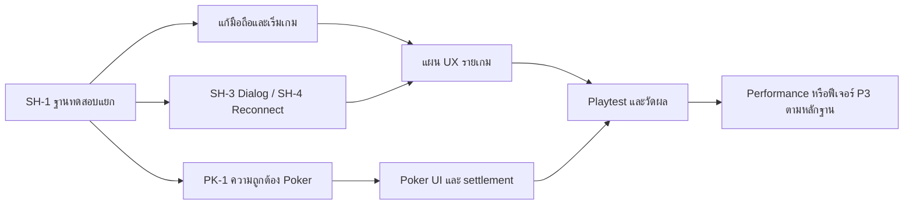

# KZ Game Hub — แผนปรับปรุงภาพรวมและรายเกม

วันที่ตรวจ: 13 ตุลาคม 2026 · baseline commit `c03c820c` · สถานะ: **ชุดงานด่วนกำลังส่งมอบ; งานที่เหลือ Proposed**

เว็บมีพื้นฐานที่ดีสำหรับเล่นกับเพื่อน: ห้องเดียวรองรับ 14 เกม, state ตัดสินจาก server, แยกข้อมูลลับ, reconnect token, ภาษาไทย/อังกฤษ, กติกาในเว็บ และ E2E จำลองเล่นจนจบหลายโหมด. งานที่ควรทำก่อนคือแก้ความถูกต้องของ Poker, การเข้าถึงปุ่ม/ไพ่บนมือถือ และการกู้สถานะเมื่อเริ่มหรือเชื่อมต่อไม่สำเร็จ. หลังจากนั้นจึงปรับคำแนะนำในแต่ละช่วงและความน่าเล่น.

นี่เป็นแผนจากการตรวจโค้ดและทดลองเว็บบนเครื่อง ไม่ใช่ผลทดสอบ production ทั้งระบบ. [หลักฐานและขอบเขตการทดสอบ](2026-10-13-game-audit-evidence.md) แยก UI ที่เห็นจริง, ข้อค้นพบจาก CODE และข้อเสนอที่ต้องทดลองกับผู้เล่นไว้แล้ว. หลังผู้ใช้สั่งเริ่มงานด่วน ได้แก้ code ใน branch `fix/urgent-gameplay`; ดู [ผลแก้และหลักฐานตรวจ](../../qa/2026-10-13-urgent-fixes.md). ข้อค้นพบด้านล่างเป็น baseline ก่อนแก้.

## ขอบเขตและสมมติฐาน

- ใช้มือถือคนละเครื่องและเล่นเป็นกลุ่ม ทั้งนั่งโต๊ะเดียวกันและคุยผ่านช่องทางภายนอก; ไม่มีข้อกำหนดให้สร้าง voice chat ในงานรอบแรก
- คงแนวภาพเส้นขอบดำ สีสด และภาษาไทยเป็นหลัก; ไม่ย้าย turn-based board/card games ไป Phaser หรือ canvas
- นับตาม `GameType` 14 เกม; Classic/Gobbler/Ultimate อยู่ในแผน Tic-Tac-Toe, ป๊อกเด้ง/Slave อยู่ในแผนเกมไพ่ไทย, Online/Ledger อยู่ในแผน Poker ตาม ADR ปัจจุบัน
- แผนวันที่ 8 ตุลาคมยังใช้เป็น visual reference แต่ชุดวันที่ 13 นี้เป็นแผนจัดลำดับงานจาก baseline ปัจจุบัน. สิ่งที่ทำแล้วไม่ต้องสร้างซ้ำ: game catalog description, GameStatusHeader, Knowguise phase stepper/private role/sealed vote/reduced motion
- ยังไม่สรุปว่า frontend ช้าหรือเกมเสียสมดุลโดยไม่มีผลวัด/ข้อมูลผู้เล่นจริง

## สิ่งที่ควรปรับก่อน

| ลำดับ | ปัญหา/หลักฐาน                                                                                                                                                | ผลต่อผู้เล่น                                                         | งานที่รับผิดชอบ                                  |
| ----- | ------------------------------------------------------------------------------------------------------------------------------------------------------------ | -------------------------------------------------------------------- | ------------------------------------------------ |
| P0    | E2E โหลด root `.env`; ปิดเฉพาะ GameSettings DB แต่ผลเกมยังเขียน DB และ Sounds Fishy increment query_count; Turbo dev ไม่ส่ง env override ที่ไม่ได้ allowlist | การทดสอบปกติอาจแตะข้อมูล production                                  | SH-1: แยกฐานทดสอบและ fail closed                 |
| P1    | Poker preflop BB20 เสนอขั้นต่ำ Raise to21; CODE เขียน minRaiseTo ทับและคำนวณ raise increment/short all-in ไม่ตรง contract                                    | เดิมพันผิดกติกาและอาจเปิดสิทธิ์ raise ผิด                            | PK-1 ก่อนปรับ UI Poker                           |
| P1    | มือไพ่ Slave 26 ใบเป็น flex แถวเดียว ถูกตัดที่ 360px                                                                                                         | เลือกไพ่บางใบไม่ได้จากมือที่แสดง                                     | CA-1                                             |
| P1    | Home ปุ่ม Join และ Coup ปุ่ม Return/Assassinate เลยขอบจอ 360px                                                                                               | เข้าห้องหรือทำ action ไม่สะดวก                                       | SH-2, CP-1                                       |
| P1    | Music artist preset ยังถูก start guard ตรวจ query ว่าง                                                                                                       | ตั้ง preset แล้วเริ่มไม่ได้บางสถานะ                                  | MT-1                                             |
| P1    | Rules modal กด Escape แล้วยังเปิด; card actions หลายเกมใช้ div/hover                                                                                         | keyboard/touch เข้าถึงคำสั่งไม่ครบ                                   | SH-3, TT-2, DC-1                                 |
| P1    | หน้า disconnected แสดง Connecting เพียงอย่างเดียว; emitter ไม่ตรวจ socket.connected; actionLoading ปลดจาก broadcast ใดก็ได้                                  | ไม่รู้ว่าคำสั่งถึง server หรือยัง; เสี่ยงส่งคำสั่งเก่าหลัง reconnect | SH-4; stale-action risk ยังต้อง regression เพิ่ม |
| P2    | หลายเกม GameStatusHeader ใช้คำแนะนำทั่วไป แม้ผู้เล่นแต่ละบทบาทต้องทำคนละอย่าง                                                                                | ผู้เล่นใหม่ต้องเปิดกติกาซ้ำ                                          | แผนแต่ละเกม + SH-5                               |
| P2    | reduced motion มีชัดใน Knowguise/RoleCard แต่ยังไม่ทั่ว; media errors หลายจุดอยู่ console                                                                    | ผู้ใช้บางกลุ่มพลาด feedback/แก้เสียงเองไม่ได้                        | SH-3, MT-2, งานเฉพาะเกม                          |

P0 = ต้องจัดการก่อนรันชุดที่เขียน DB; P1 = ความถูกต้อง/คำสั่งหลักเข้าถึงไม่ได้; P2 = usability/feedback; P3 = ทดลองฟีเจอร์เพิ่ม. ขนาด S/M/L ใช้เปรียบเทียบความซับซ้อน; ไม่ใช่ estimate เวลาที่รับปาก.

## สถานะชุดงานด่วน

| Task        | ส่งในรอบนี้                                            | งานที่ยังอยู่ในแผน                                           |
| ----------- | ------------------------------------------------------ | ------------------------------------------------------------ |
| SH-1        | runner/config แยก local DB, guard และ Turbo env        | ผล GitHub workflow ต้องตรวจจาก run จริง                      |
| PK-1 / PK-2 | minimum/full raise/short all-in และ UI ที่เกี่ยวข้อง   | pot breakdown/ledger award UX                                |
| SH-2 / CP-1 | Home Join, Coup header/target actions ที่ 360px        | ตรวจอุปกรณ์จริง/soft keyboard/zoom และ shared utilities อื่น |
| CA-1        | scroll ไพ่ครบ 26 ใบ + aria-pressed                     | sort และ legal-selection hints                               |
| MT-1        | preset/query eligibility พร้อมเหตุผล                   | media provider recovery/ready gesture                        |
| SH-3        | Rules dialog Escape/Tab/focus                          | migrate dialogs อื่นและ reduced motion ทั้งแอป               |
| SH-4        | connection states/retry, ปิด actions offline, คืน seat | correlated ack/snapshot request และ clock-skew protocol      |

รายละเอียดผลทดสอบและข้อจำกัดอยู่ใน [บันทึกส่งงาน](../../qa/2026-10-13-urgent-fixes.md).

## แผนแยกรายเกม

| เกม                      | ควรเริ่มจาก                               | ต่อจากนั้น                                       | ขนาด | แผน                                                         |
| ------------------------ | ----------------------------------------- | ------------------------------------------------ | ---- | ----------------------------------------------------------- |
| รู้แล้วเงียบ / Knowguise | ปิด role card ข้ามรอบ/สลับแท็บ            | หน้าที่คนตั้งคำ, เหตุผลชนะ                       | M    | [Who Know](2026-10-13-who-know-improvements.md)             |
| Tic-Tac-Toe 3 โหมด       | keyboard labels, Gobbler button semantics | Ultimate แผง 3×3 มือถือ, next-board preview      | L    | [Tic-Tac-Toe](2026-10-13-tic-tac-toe-improvements.md)       |
| Hand Duel                | ชื่อค้อน/กระดาษ/กรรไกร                    | คนพักใน Round Robin, draw/match result           | S    | [RPS](2026-10-13-rps-improvements.md)                       |
| คำตอบพราง / GuiseGuess   | error คลังคำถามและ retry                  | ส่ง true answer, แยก reveal/eliminate/bank       | M    | [Sounds Fishy](2026-10-13-sounds-fishy-improvements.md)     |
| รหัสภาพ / Cluecanvas     | ดูภาพ/ลงภาพบน touch และ keyboard          | focus dialog, โต๊ะภาพและเหตุผลคะแนน              | M    | [Detective Club](2026-10-13-detective-club-improvements.md) |
| ฉันคือใคร                | host-input ภาษาไทยและ mode validation     | เก็บ draft เมื่อ reject, guess/vote status       | M    | [Who Am I](2026-10-13-who-am-i-improvements.md)             |
| ใครกดก่อน                | สัญญาณกดหลายรูปแบบ                        | ระบุ network delay, server-clock display         | M    | [Who First](2026-10-13-who-first-improvements.md)           |
| แฟนพันธุ์แท้เสียงเพลง    | preset start guard                        | local audio recovery, readiness และ timers       | L    | [Music Trivia](2026-10-13-music-trivia-improvements.md)     |
| นับในใจ / Countaline     | readiness และ Extreme piles               | ไม่บังคับรอ blind reveal, reconnect identity     | M    | [The Mind](2026-10-13-the-mind-improvements.md)             |
| คนแคระจอมป่วน            | ขยาย/เลื่อนกระดานมือถือ                   | target prompts, log และ gold pick                | L    | [Saboteur](2026-10-13-saboteur-improvements.md)             |
| บ้านทรายทอง              | ปุ่มล้นจอ                                 | challenge/block countdown, exchange feedback     | L    | [Coup](2026-10-13-coup-improvements.md)                     |
| เกมไพ่ไทย                | มือไพ่ Slave เข้าถึงครบ                   | legal-selection hints, ป๊อกเด้ง settlement       | L    | [Card Game](2026-10-13-card-game-improvements.md)           |
| ลิงแอบกล้วย              | ready/audio/force-start confirmation      | สัญญาณตื่น, peek, vote/reveal                    | L    | [Banana Thief](2026-10-13-banana-thief-improvements.md)     |
| Poker                    | minimum raise/full vs short all-in        | legal action UI/i18n, pot breakdown/ledger award | L    | [Poker](2026-10-13-poker-improvements.md)                   |

## ลำดับส่งงาน

1. **ฐานทดสอบและบั๊กหลัก:** SH-1 → PK-1, SH-2, CA-1, CP-1, MT-1. ส่งเป็น changeset เล็กแยกกัน; PK-1 เปลี่ยน betting engine จึงต้องผ่าน regression ทั้ง Online/Ledger
2. **ความต่อเนื่องของห้อง:** SH-3/SH-4 → start failure, private info lifecycle, input rejection, keyboard controls. ใช้ Classic/RPS เป็นกลุ่มทดลอง shared behavior ก่อนนำไปเกมซับซ้อน
3. **ประสบการณ์รายเกม:** เริ่มจาก TT/DC/WA/MT/SA/CP ที่มีหลายขั้น แล้วเกมที่เหลือ. ทุกเกมส่งได้แยก ไม่ต้องรอปรับครบ 14 เกม
4. **วัดผลและขยาย:** SH-5 → playtest ผู้เล่นใหม่ → SH-6 เฉพาะถ้าพบ performance bottleneck. ประเมิน P3 จากปัญหาที่วัดได้

## เกณฑ์ร่วมก่อนปิดงาน

- [ ] 360×800, 390×844, 1280×900; ไทย/อังกฤษ; ข้อความยาว; soft keyboard; ช่องที่เลื่อนตั้งใจมีกรอบและ affordance ชัด
- [ ] หน้าเริ่ม/เล่น/รอ/ผล แสดง phase, หน้าที่ของฉัน และ action ต่อไป; guest/viewer/host คนละสิทธิ์ตรง server
- [ ] keyboard เล่น action หลักได้; modal trap/restore focus; สีไม่ใช่สัญญาณเดียว; reduced-motion และ mute ไม่ลบสารสำคัญ
- [ ] reconnect กลาง phase ที่แก้คง seat/บทบาท/hand/vote ถูก; timer ไม่ reset และคำสั่งที่ stale ไม่ถูก replay
- [ ] targeted Jest + E2E + sim variants ของเกมผ่าน. มี regression สำหรับบั๊กจริง ไม่เพิ่ม test ตรวจ className สำหรับ polish
- [ ] ไม่มี secret data เพิ่มใน room broadcast, DOM ของคนไม่เกี่ยวข้อง, log หรือ telemetry
- [ ] บันทึกผลที่ตรวจจริงและข้อจำกัด; ไม่กล่าวว่า Safari/media/live adapters ผ่านจาก Chromium stub

## งาน P3 ที่ควรทดลองก่อนสร้าง

- Filter เกมตามจำนวนคน/แนว/ความยาก และ catalog time estimate: playtest ก่อนว่าช่วยเลือกจาก 14 เกมเร็วขึ้นจริง; อย่าเดาเวลาเล่นลง catalog
- Voice chat, matching คนแปลกหน้า, account/profile, room resume หลัง server restart: ต้องแยก product/infrastructure decision เพราะเพิ่มขอบเขตและค่าใช้จ่าย. In-memory rooms ปัจจุบันไม่รอด restart; UI ควรอธิบายเมื่อ session หายก่อน
- ระบบ tutorial เต็ม, role notebook, hints อัตโนมัติ: บางเกมตั้งใจให้จำ/อ่านใจ/บลัฟ; ไม่เพิ่มความช่วยเหลือที่เปลี่ยนทักษะหรือความลับโดยตีความว่าเป็น polish
- Content quality ของคำถาม/คำทาย/เพลง: ใช้ sample ที่ผ่าน review และแยกภาษา; งานเนื้อหาอาจสำคัญกว่าเอฟเฟกต์ แต่รอบนี้ไม่ได้ประเมินคลัง production

## การติดตาม

ใช้ Task IDs ในแผน (SH/PK/CA/CP ฯลฯ) เป็นหน่วยส่งงาน. Checkbox แสดงขอบเขตที่ทำจริง; งานที่ส่งบางส่วนมีหมายเหตุเพื่อไม่สรุปว่าปิดทั้ง task แล้ว. แผนเก็บใน Git ที่ `docs/superpowers/plans/`; ถ้าแตก issue ใช้ `.scratch/` ตาม `docs/agents/issue-tracker.md` และลิงก์กลับ Task ID. ไม่เปิด issue ภายนอกหรือส่งข้อความหาผู้อื่นในงานนี้.

แหล่งอ้างอิงด้าน interaction: ขนาดเป้าสัมผัสขั้นต่ำ 24px และข้อยกเว้นระยะห่างตาม [W3C WCAG 2.2](https://www.w3.org/WAI/WCAG22/Understanding/target-size-minimum.html); แผนนี้ตั้งเป้า 44px สำหรับคำสั่งสำคัญบนมือถือเป็นเป้าหมายออกแบบ. การจัดการ modal อิง [W3C APG](https://www.w3.org/WAI/ARIA/apg/patterns/dialog-modal/); ข้อจำกัดการรับส่ง event อิง [Socket.IO delivery guarantees](https://socket.io/docs/v4/delivery-guarantees/). กติกา minimum raise อิง [PokerStars Hold'em rules](https://www.pokerstars.com/poker/games/texas-holdem/).
